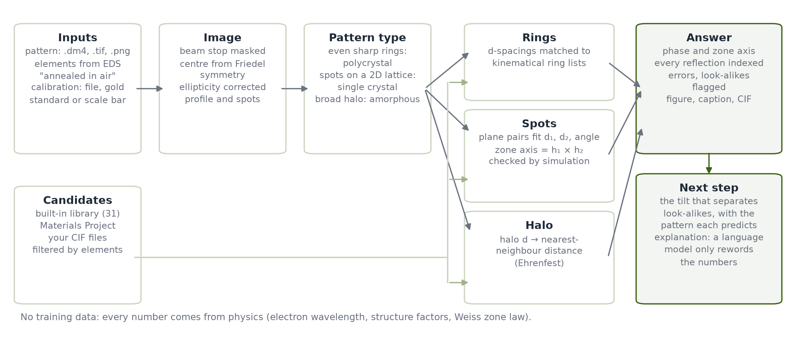
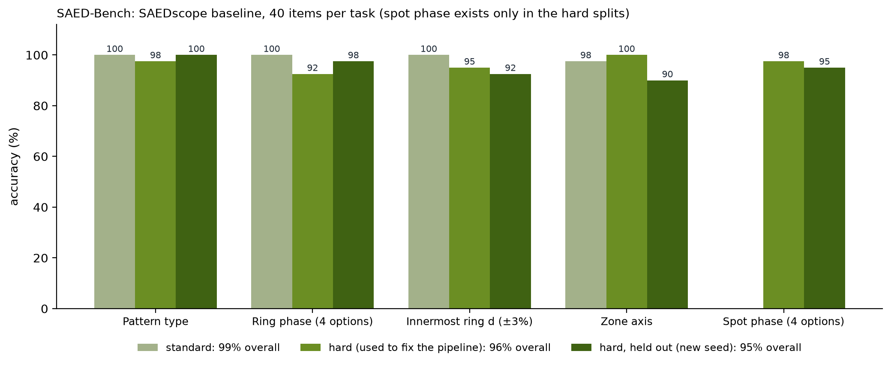
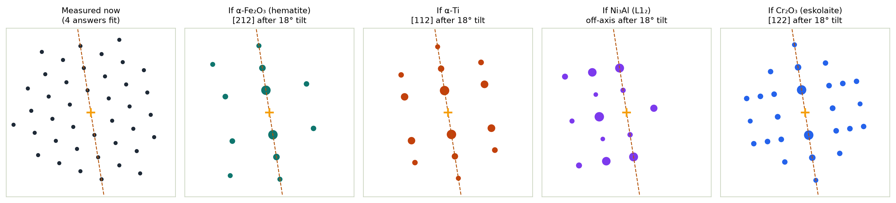

# SAEDscope and SAED-Bench

October 2026 · draft for the OSI Hackathon (the live, editable version is the team's Claude doc)

SAEDscope reads a selected-area electron diffraction pattern plus one sentence about the sample. It returns the pattern type, the phase, the zone axis and every indexed reflection, with no training data. When several answers fit, it says which specimen tilt will tell them apart. On SAED-Bench, our new benchmark of 560 auto-graded diffraction questions, SAEDscope scores 99% on standard patterns and 95.5% on held-out realistic ones. On our own microscope, it caught scale bars that were 10% off, then indexed a gold crystal to within 0.2%. The same benchmark is ready to measure general vision-language models.

## Problem

Indexing a selected-area electron diffraction (SAED) pattern is still done largely by hand: measure ring radii or spot spacings, convert them to d-spacings, guess candidate phases, then check plane pairs and angles until one zone axis fits. A single pattern takes minutes to an hour, and look-alike phases are easy to confuse.

Existing tools each cover part of the job:

- **Classical indexing software** (e.g. CrysTBox) matches spacings and angles well, but the user must already supply the candidate phases.
- **Classifiers trained on simulated patterns** recognise a fixed set of phases or crystal systems, but they do not name an arbitrary material or explain their answer. Mika et al. (*J. Materiomics*, 2024) reached 66–73% on 9 Pu–Zr phases; Nathani et al. (*npj Comput. Mater.*, 2026) reached 89% for crystal system.
- **General vision-language models** accept any image, but nobody has measured whether they can index a diffraction pattern.

Missing so far: a tool that goes from a pattern plus a sentence about the sample to a named phase and zone axis, shows its evidence, and says what to measure next when the answer is ambiguous. Also missing: a benchmark that tests AI models on this task.

## Approach: SAEDscope

SAEDscope uses physics, not training, to turn a pattern and a short sample description into a phase, a zone axis and indexed reflections. Every number it reports comes from electron-diffraction physics: the relativistic wavelength, kinematical structure factors with Doyle–Turner electron scattering factors, and the Weiss zone law.

Rings and spots are scored against every candidate; the answer, its evidence and the next measurement come out together.

1. **Image.** The beam stop is masked and inpainted. The centre comes from Friedel symmetry; for weak spot patterns, from the midpoints of Friedel pairs (g, −g). Ring ellipticity measured on a gold standard is corrected.
2. **Pattern type.** Even, sharp rings mean a polycrystal; spots on one 2D lattice mean a single crystal; a broad halo means amorphous. Combinations are reported as mixed.
3. **Candidates.** Phases whose elements are a subset of those given ("Ni, Al, O", or "NiAl annealed in air") come from a built-in library of 33 phases, the Materials Project or the user's CIF files.
4. **Rings.** Measured d-spacings are matched to each candidate's ring list, allowing a small uniform scale error. The score combines rings explained, missing strong lines, d-spacing error and intensity order.
5. **Spots.** A 2D lattice is fitted; plane pairs that match both spacings and the angle give the zone axis as h₁ × h₂. Each answer is then checked against the simulated zero-order Laue zone, and intensity on forbidden positions is penalised.
6. **Next step.** Each competing (phase, zone) answer fixes a crystal orientation. SAEDscope searches low-index zones within ±35° of tilt and simulates what every answer predicts after the same tilt. It then recommends the tilt that separates them, for example: "tilt 18° along the (010) row; if α-Ti you will see \[112\]…". For look-alike ring patterns it lists the rings one candidate has and the other lacks.
7. **Explanation.** A language model, when enabled, only rewords the structured result and may use only the numbers in it. A built-in template does the same job without a model.

## SAED-Bench

SAED-Bench asks diffraction questions that have exact answers, so any model can be graded automatically. Each item is a 640 × 640 8-bit PNG (log-scaled, as in papers) plus a text prompt. The prompt gives the calibration in Å⁻¹ per pixel and the approximate centre. Patterns are simulated from the 31 library structures, so the ground truth is known. Generation is deterministic from a seed.

| Task | Question | Graded as | Split |
| --- | --- | --- | --- |
| Pattern type | single crystal, polycrystalline or amorphous? | exact (chance 33%) | standard, hard |
| Ring phase | which of 4 phases made these rings? | letter (chance 25%) | standard, hard |
| Innermost ring d | d-spacing of the smallest ring, in Å | within ±3% | standard, hard |
| Zone axis | \[uvw\] of a spot pattern of a named phase | any symmetry-equivalent direction | standard, hard |
| Spot phase | which of 4 phases made this spot pattern? | letter (chance 25%) | hard |

- **Standard split (v0, 160 items):** clean kinematical patterns on the zone axis, with beam stop, Poisson noise, spotty rings and occasional double diffraction.
- **Hard split (v0-hard, 200 items):** what microscopists actually see. Crystals are 0.5–2.5° off the zone axis, so intensities follow the Laue circle. Dynamical intensity scatter is strong, and some spots sit at forbidden positions. Projector ellipticity reaches 1.5%, and the nominal calibration is only good to ±1.5%. Ring patterns are textured or very coarse-grained, often over an amorphous carbon-film halo, at low counts. Distractor phases in spot phase are checked so that none has a zone with the same 2D lattice. A second hard split, generated from a new seed (200 items), is kept as a held-out test.

Vision-language models run through one script, which works with Anthropic or any OpenAI-compatible endpoint, including local open models. The script is resumable and parses the answer from a final `ANSWER:` line.

## Results

SAEDscope answered 159 of 160 standard questions (99%), and 191 of 200 on a held-out hard split it was never tuned on (95.5%).

The hard split found real weaknesses. SAEDscope first scored 82% on it, for three reasons that also matter on real data:

- Weak off-axis spot patterns were missed (zone axis 70%).
- Sharp rings on a carbon-film halo merged with the halo (innermost ring 78%).
- Coarse-grained polycrystals were confused with single crystals.

Three physics-based fixes raised the score to 96.5%: keep weak spots only if their Friedel partner is also found, search for rings on top of a halo, and count Friedel pairs to separate one crystal from many grains. A fresh hard split generated afterwards with a new seed scored 95%, so the fixes generalise rather than fit the test. Changes made later for real data (small detectors, paper figures) were run on all splits only as a regression check: 97.5% hard, 95.5% held out.

The remaining misses are very weak patterns with six spots or fewer, textured rings whose innermost ring hides under the halo, and look-alike phases under a ±1.5% calibration error.

The next-step advisor resolves ambiguity that no score shows. Take a hexagonal pattern with no elements given: four answers fit, α-Ti \[001\], hematite \[001\], Ni₃Al \[111\] and Cr₂O₃ \[001\]. SAEDscope recommends an 18° tilt along the (010) spot row. After that tilt, each answer predicts a different pattern: \[112\], \[212\], off-axis and \[122\].

Vision-language models are run with the same images and prompts. Their scores go here before submission:

| Model | Standard split | Hard split, held out |
| --- | --- | --- |
| Claude (vision) | to run | to run |
| GPT-class model | to run | to run |
| Open-weight vision model | to run | to run |

## First real data: gold on our microscope

On three patterns from our own microscope, SAEDscope caught scale bars that were about 10% off. After calibrating with gold rings, it indexed a gold crystal to within 0.2%.

| Pattern | Calibration used | SAEDscope result |
| --- | --- | --- |
| Au single crystal | burnt-in scale bar (5 nm⁻¹ = 189 px) | with elements Au: Au [100], but every spacing 12% smaller than gold, flagged as a calibration error; without elements, austenite, Ni₃Al or Cu fit at that scale |
| Au rings, 660 mm | fitted to the gold rings | 5 rings, rms error 0.62%; calibration 10.8% below the scale bar |
| Au rings, 890 mm | fitted to the gold rings | 7 rings, rms error 0.31%; calibration 9.7% below the scale bar |
| Au single crystal | 660 mm gold rings | Au [100]: d(200) 2.042 and 2.037 Å against 2.039 Å, 89.5° against 90°, 98% of spot intensity explained |

Without that check, the scale bar would have produced a confident wrong answer. Instead, SAEDscope named the measurement that settled it.

## Ground truth: MgO nanocrystals

A public 4D-STEM scan of MgO nanocrystals (`mgo_nano.zspy` from the pyxem demo data, C. Francis, Zenodo 14113591, CC BY 4.0; 105 × 105 scan positions, 300 kV, calibration stored in the file) served as a known-answer test. SAEDscope reads the file directly.

| Input | SAEDscope result |
| --- | --- |
| All positions overlaid (max), elements Mg, O | MgO |
| Same, no elements given | TiN / MgO look-alike group (lattices 0.5% apart): flagged, not guessed |
| Same, checked against four CIFs (MgO, Au, Al, Cu) | MgO consistent: 6 of 8 rings, mean d error 0.8%, refined lattice within 0.4% of the CIF. The missing 222 and 422 rings are explained by a common [001] orientation (cubes lying on a face). Au fits only with a 3.2% larger lattice; Al and Cu are not consistent |
| Single scan positions (6 tested) | 5 show one systematic row with d = 1.47–1.51 Å (MgO 220 within 1.1–1.4%). One row cannot fix the zone axis, and other phases fit it as well, so the tool asks for a tilt. One noisy position failed |

## Ground truth: gold cross-grating calibration file

The gold cross-grating pattern from the pyxem calibration tutorial (`au_xgrating_20cm.tif`, same Zenodo record; 256 × 256 px, camera length 20 cm, no calibration in the file) is a second known answer. It exposed a real bug: on so small a detector the gold rings are 5–8 px wide, which the relative-width rule took for amorphous halos. Rings only a few pixels wide are now judged against the typical width of the clearly sharp rings in the same pattern, and a peak about twice as wide is tested as two unresolved rings (fcc 111 + 200).

| Test | SAEDscope result |
| --- | --- |
| Before the fix | "amorphous" (wrong) |
| Identify, elements Au, no calibration | polycrystalline Au, 5 rings (111/200 doublet resolved), mean ratio error 0.5% |
| Same, no elements | fcc look-alike group (Al, Ni, Pd, Cu, Au …): correct, ratios alone cannot separate them |
| Used as a gold standard | 0.01002 Å⁻¹/px (rms 0.64%), ellipticity 1.7% (3.4% between the axes) |
| pyxem tutorial, same file | 0.010237 Å⁻¹/px after its elliptical correction, which keeps one axis and shrinks the other by 3.5%. On that footing (short-axis radius) SAEDscope gives 0.01020, 0.4% from pyxem |

## A figure cropped from a paper

A cubic BaTiO₃ [001] pattern cropped from a published figure (248 × 248 px, 8-bit and saturated, beam stop over the direct beam, "5 1/nm" scale bar) exposed three failures, all fixed: the centre locked onto a half-lattice point (a spot lattice is symmetric about those too, and the direct beam was hidden), spots inside the saturated glow were missed, and spots beyond the nearest image edge were not predicted. Now the centre comes from the diffuse glow and the end of the beam stop, fixed to the hidden lattice point; the scale-bar label is masked. Result with elements Ba, Ti, O and the scale bar: BaTiO₃ [001] first (score 0.82), with every d-spacing 8.9% smaller than expected, i.e. the scale bar is about 9% off (the 100 reflections are kinematically very weak, so the visible spots are 110 and 200). Rescaled by that 9%, every detected spot indexes as BaTiO₃ [001]; an absolute d-spacing check would need a trustworthy calibration.

## Limitations and next steps

The main open item is more real data: the benchmark numbers come from simulated patterns, and the SAEDscope scores are optimistic because the benchmark and the pipeline share the same kinematical physics. So far, three real patterns from one microscope and two public datasets with known answers (a 4D-STEM scan of MgO and a gold calibration grating) have been tested (above).

- **More real data:** add our polycrystalline and amorphous patterns, and patterns from other microscopes, as a real split with expert answers.
- **Kinematical model:** intensities are used only as a weak hint. Thick crystals and strong dynamical effects can still mislead the ranking.
- **Look-alikes:** phases whose lattices differ by less than about 1–2% (Au and Al, for example) cannot be separated by d-spacings alone. SAEDscope flags them and suggests the measurement that would separate them.
- **Calibration:** without it, only spacing ratios are used, and phases of the same structure type become indistinguishable. A gold standard taken at the same camera length removes this.
- **Tilt advice** assumes the diffraction pattern is not rotated relative to the holder axes; the image–diffraction rotation must be checked on each microscope.
- **Not yet exercised:** reading `.dm3`/`.dm4` files from real microscopes, the Materials Project lookup and the language-model calls. All three are implemented but were untested offline.
- **Next:** a CBED and precession-electron-diffraction mode, a dynamical (Bloch-wave) intensity check for the final ranking, and batch maps for 4D-STEM.

## Code, data and provenance

The repository contains the SAEDscope app (Streamlit), the analysis engine, the benchmark generator, the model runners and the tests. It is open source; the license is still to be chosen. The benchmark images are not stored: one command regenerates each split identically from its seed. The app can be hosted as a Hugging Face Space from the included Dockerfile.

- **Repository:** link to be added before submission.
- **Live demo:** link to be added once the Space is up.
- **Provenance:** a starter version of the code was prepared before the event with an AI coding assistant. The team will state here exactly what was built during the event, for example the real-data evaluation, the real split, the write-up and the demo.
- **Data:** only simulated patterns and public structures are included. Unpublished lab patterns are used only with the advisor's permission.
